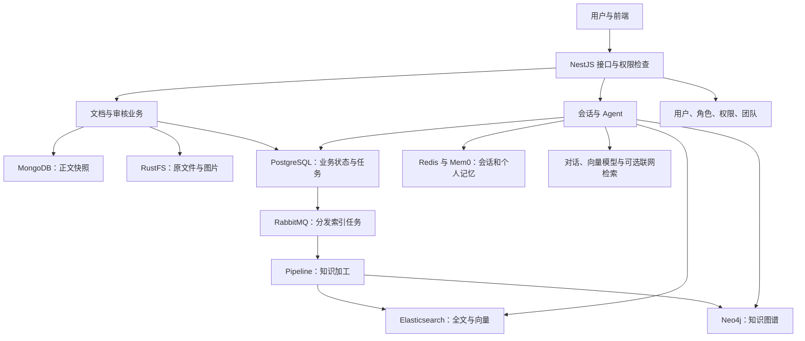
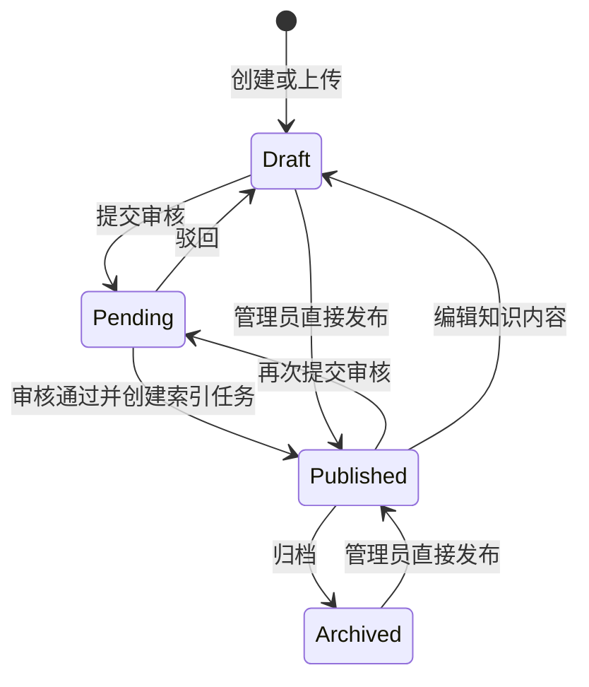
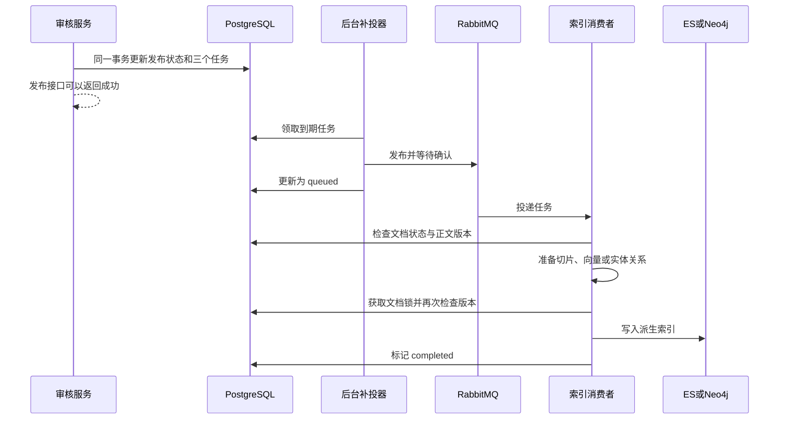
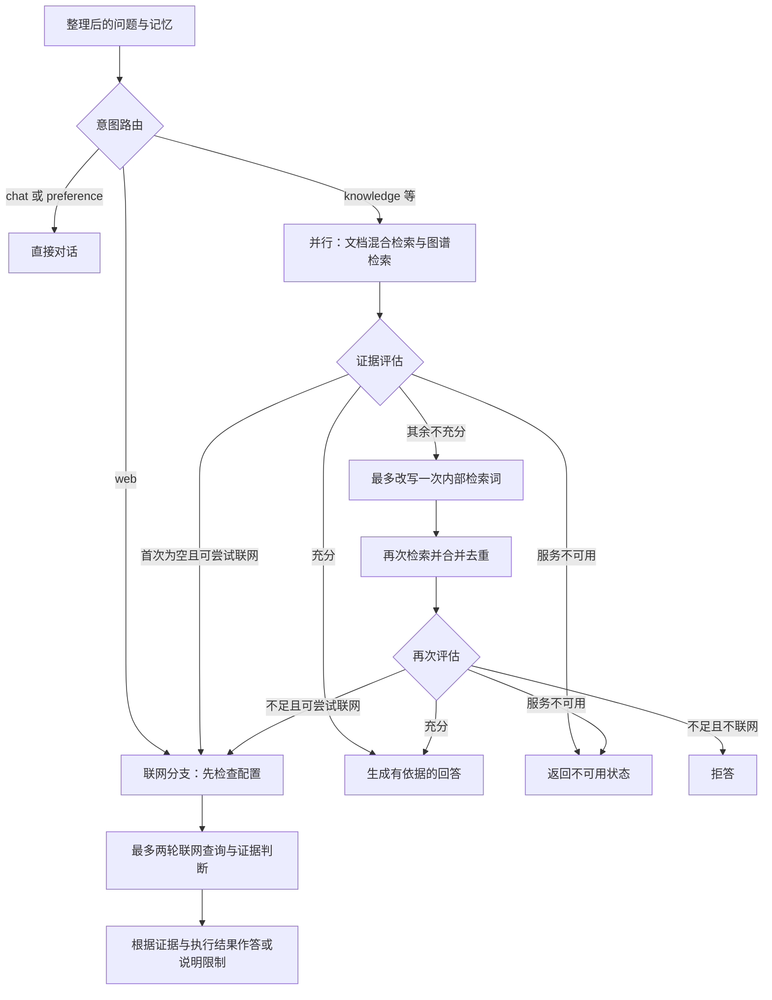

# Backend 项目代码理解手册

依据：2026-11-12 当前工作区代码，包括本轮之前已修改但尚未提交的实现。

项目目录：`/Users/balala/Desktop/workspace/Summary/backend`。

这份手册按“业务目标 → 数据 → 流程 → 函数 → 排查方法”组织。示例中的制度、人员和 ID 都只是讲解用的假设，不代表数据库实际内容。

## 1. 先理解项目到底在做什么

这是一个带审核发布、组织权限和多轮问答的企业知识库后端。

它把企业文档加工成可以搜索、关联和引用的知识，再根据用户问题选择检索、补充检索、联网或直接对话，最后给出带来源的回答。

业务可以分成两条主链：

1. **知识生产链**：上传文件 → 解析 Markdown → 保存草稿 → 提交审核 → 发布 → 异步构建全文、向量和图谱索引。
2. **知识消费链**：用户提问 → 整理上下文 → 判断意图 → 检索证据 → 判断是否足够 → 必要时重查或联网 → 生成回答 → 保存消息和记忆。

用户、角色、权限、团队是这两条链的业务支撑；消息队列、数据库、追踪和评测是运行支撑。

当前 Agent 是**由程序限定步骤和次数的问答决策流程**。模型负责分类、改写、判断证据和组织语言，代码决定能调用哪些能力、什么时候停止。当前没有任意业务操作工具集、多 Agent 协作或可从中途检查点恢复的工作流引擎。



## 2. 代码目录各自负责什么

| 目录 | 业务职责 | 阅读时要回答的问题 |
| --- | --- | --- |
| `auth` | 注册、登录、令牌、邮箱验证、密码重置 | 当前请求是谁发出的？ |
| `user` | 用户、角色及绑定关系 | 谁在使用系统，是什么角色？ |
| `permission` | 菜单、操作权限及角色/用户授权 | 当前用户能调用这个操作吗？ |
| `team` | 团队层级、成员、负责人 | 人员如何归属组织？ |
| `document` | 文档、正文引用、审核、状态和文档权限 | 哪一版知识有效，谁可以看？ |
| `parser` | 各类文件转 Markdown | 文件如何变成可加工的正文？ |
| `storage` | RustFS 对象存储、原文件和图片上传 | 二进制文件放在哪里？ |
| `pipelineManager` | 切片、向量化、全文索引、图谱抽取、任务恢复 | 发布后知识如何进入检索系统？ |
| `mq` | RabbitMQ 发布确认、消费、重连、重试 | 后台任务如何可靠送达？ |
| `search` | 面向搜索页面的整篇文档全文检索 | 如何找出相关文档和高亮？ |
| `graph` | 图谱查询及文档权限过滤 | 关系信息如何查出并追溯原文？ |
| `ai` | RAG、Agent、会话、流式响应、记忆、追踪 | 一次问题如何变成最终回答？ |
| `ai/eval` | 数据集、检索指标、回答评分和报告 | 如何判断效果是否变好？ |

注意三组容易混淆的名字：

- `search` 是搜索页面的文档全文搜索；`ai/hybrid-retriever.ts` 是问答使用的切片混合检索。
- `pipelineManager/graph*` 负责“写图谱”；`graph/graph.service.ts` 负责“查图谱”；`ai/graph-passages.ts` 把图谱查询结果整理成回答证据。
- `ai/chat-memory*` 是短期对话上下文；`ai/mem0*` 是跨轮次、部分跨会话的个人记忆。

## 3. 请求如何进入代码

入口：[main.ts](/Users/balala/Desktop/workspace/Summary/backend/src/main.ts)。

启动时先初始化追踪，再创建 Nest 应用、注册全局参数校验、监听端口。默认端口是 3000，可以由 `PORT` 覆盖。

一个业务请求大致经历：

```text
HTTP 请求
→ JWT 身份检查
→ 角色检查
→ 操作权限检查
→ DTO 参数转换和校验
→ Controller 提取参数与当前用户
→ Service 执行业务
→ Repository / 数据库 / 外部能力
→ 返回普通 JSON 或流式事件
```

理解一个功能时，建议先看 Controller 找入口，再看 Service 的主方法，最后沿着调用深入。不要从所有基础设施实现开始读。

关键入口：

- [app.module.ts](/Users/balala/Desktop/workspace/Summary/backend/src/app.module.ts)：系统装配哪些业务模块。
- [auth.module.ts](/Users/balala/Desktop/workspace/Summary/backend/src/auth/auth.module.ts)：全局身份、角色和权限守卫。
- [document.module.ts](/Users/balala/Desktop/workspace/Summary/backend/src/document/document.module.ts)：文档模块，同时配置 PostgreSQL 和 MongoDB 连接。
- [storage.module.ts](/Users/balala/Desktop/workspace/Summary/backend/src/storage/storage.module.ts)：同时注册全局配置模块。

后两点说明：当前基础设施配置分散在业务模块中，模块名称不能完全代表它的职责边界。

### 启动阶段也会改动数据

PostgreSQL 配置使用 `synchronize: false`，不能理解成“应用启动会自动根据所有实体建表”。

但部分服务确实包含启动初始化：

- `DocumentService.onModuleInit`：兼容旧正文 ID，把文档引用迁移到 Mongo `_id`，处理旧字段和索引。
- `ChatSchemaService.onModuleInit`：确保会话、消息和运行租约表存在。
- `PipelineManagerService.onModuleInit`：确保任务表和索引存在，并注册消费处理函数。
- 权限种子服务：补齐部分操作权限及管理员授权。
- MQ 和 Pipeline 的启动逻辑：准备队列、消费与任务补投。

排查“为什么只启动服务就出现 SQL 或 Mongo 更新”时，要先看这些方法。

## 4. 数据分布：哪一份说了算

| 存储 | 保存内容 | 在系统中的地位 |
| --- | --- | --- |
| PostgreSQL | 用户、权限、团队、文档元数据、审核、会话消息、任务和租约 | 业务状态和访问控制的判断依据 |
| MongoDB | `document_content` 中的 Markdown 正文、长度和摘要等 | 文档正文快照 |
| RustFS | 原始文件和解析出来的图片 | 二进制对象存储 |
| Elasticsearch | 整篇全文索引；切片文本和向量 | 可以重建的检索数据 |
| Neo4j | 文档、切片、实体及带来源的关系 | 可以重建的关系检索数据 |
| Redis | 验证码、临时令牌、会话摘要和最近消息 | 有过期时间的临时数据 |
| Mem0 | 用户事实/偏好、会话记忆 | 对话辅助上下文 |
| RabbitMQ | 待执行消息及重试消息 | 任务运输层，任务事实记录在 PG |
| LangSmith / Langfuse | 调用过程、步骤、耗时、异常等 | 诊断和观测 |

**索引里存在一段内容，不等于当前用户可以读，也不等于它还是最新版本。** 所以检索前后都需要回到 PostgreSQL 检查。

### PostgreSQL 表的业务关系

| 业务 | 表 |
| --- | --- |
| 用户与角色 | `kh_user`、`kh_role`、`kh_user_role` |
| 权限与授权 | `kh_permission`、`kh_role_permission`、`kh_user_permission` |
| 团队 | `kh_team`、`kh_team_member` |
| 文档与审核 | `kh_document`、`kh_document_review` |
| 会话 | `kh_chat_session`、`kh_chat_message`、`kh_chat_run` |
| 索引任务 | `kh_pipeline_job` |

### 必须分清的 ID

| 名称 | 表示什么 | 什么时候变化 |
| --- | --- | --- |
| `documentId` | 一篇文档的业务身份 | 修改正文时不变 |
| `contentId` | 这篇文档当前引用的 Mongo 正文快照 `_id` | 修改知识内容时产生新引用 |
| `chunkId` | 某版正文中的某个切片 | 随正文版本和切片位置变化 |
| `reviewId` / `taskId` | 一张审核单 | 每次提交形成对应审核记录 |
| `jobId` | 一个索引通道的加工任务 UUID | 三个通道各有自己的任务 |
| `sessionId` | 一段会话 | 新建会话时生成 |
| 运行 `token` | 本次会话执行的租约身份 UUID | 每次抢到运行资格时生成 |

业务雪花 ID 在代码内部可以是 `bigint`，通过接口时转字符串，避免 JavaScript 数值精度丢失。租约 token 与登录 JWT 是两种完全不同的东西。

带版本的切片 ID 类似：`documentId:contentId:切片序号`。它同时服务于去重、稳定写入和旧版本排除。

## 5. 用户、认证和权限的业务逻辑

代码入口：[auth.service.ts](/Users/balala/Desktop/workspace/Summary/backend/src/auth/auth.service.ts)、[user.service.ts](/Users/balala/Desktop/workspace/Summary/backend/src/user/user.service.ts)。

### 注册与登录

注册在事务中保存用户及角色绑定，公开注册固定授予普通用户角色，密码通过 bcrypt 哈希保存。

默认启用邮箱验证，只有相关配置明确设为 `'false'` 才关闭。验证令牌放 Redis，默认 10 分钟，验证成功后设置邮箱已验证并删除令牌。当前注册实现会返回激活链接，不应理解为只有邮件这一条交付路径。

登录检查用户名、密码、账号状态以及邮箱验证状态，更新最近登录时间，然后签发 access 和 refresh 两类 JWT。默认有效期分别为 2 小时和 7 天，使用各自的签名密钥，并检查令牌类型。

刷新会重新验证令牌和用户状态，再签发一对新令牌；当前没有独立的 refresh 撤销或轮换记录，不能认为刷新后旧 refresh 自动失效。

每次受保护请求还会从数据库重新获取有效用户和角色。因此权限判断不完全依赖 JWT 签发时附带的旧角色信息。

密码重置用 Redis 中默认 10 分钟的六位验证码。修改密码不会自动撤销所有已签发 JWT。

### 三层权限，不要混为一谈

1. **身份**：是否已登录，用户是否有效。
2. **操作授权**：是否具有某个角色或操作权限码。
3. **数据授权**：这篇具体文档是否允许当前用户查看、编辑或检索。

有效操作权限是“启用角色带来的权限”和“直接赋给用户的权限”的并集。`@Roles`、`@Permissions` 中列出多个值时，当前逻辑满足任意一个即可通过。`@Public` 绕过全局身份、角色和权限检查。

管理员不是在所有权限守卫里无条件放行；默认管理员依靠种子授权获得操作权限。具体文档数据规则中，则有管理员和审核员的特殊阅读范围。

权限的父子关系用于菜单组织，不等于拥有父级权限就自动获得全部子权限。

### 团队的真实作用

代码入口：[team.service.ts](/Users/balala/Desktop/workspace/Summary/backend/src/team/team.service.ts)、[team-member.service.ts](/Users/balala/Desktop/workspace/Summary/backend/src/team/team-member.service.ts)。

团队支持父子层级、团队编码、成员和负责人。设置负责人会同步成员角色，旧负责人会降为普通成员；移除负责人会清空对应负责人引用。不能把团队挂到自己或后代下面，有未删除子团队时不能直接删除父团队。

**当前文档上的 `teamId` 是组织归属字段，不会自动让该团队成员获得文档阅读权。** 实际文档权限判断没有使用团队成员关系。

## 6. 文档从哪里来，如何落库

主要入口：[document.controller.ts](/Users/balala/Desktop/workspace/Summary/backend/src/document/document.controller.ts)、[document.service.ts](/Users/balala/Desktop/workspace/Summary/backend/src/document/document.service.ts:103)。

有三种容易混淆的操作：

| 接口 | 做什么 | 是否产生知识库文档 |
| --- | --- | --- |
| `POST /documents` | 接收人工编写的 Markdown，保存元数据和正文 | 是，初始为草稿 |
| `POST /documents/upload/parse` | 上传文件、解析、挂载图片、保存草稿 | 是 |
| `POST /storage/source` | 只上传原始文件到对象存储 | 否 |

上传解析的调用链：

```text
DocumentController.parseUpload
→ DocumentService.parseUpload
→ parser 根据文件扩展名选择解析器
→ 得到 Markdown 和图片
→ mountImages 上传图片并替换正文链接
→ storeDocument 保存正文和文档元数据
→ 返回草稿与相关上传信息
```

解析能力：

- Word、PPT、PDF：通过本机 MinerU 命令适配层解析，默认命令 `mineru-kit`，有超时、子进程清理和临时文件清理。不能仅凭调用本机 CLI 就认定模型推理完全在本机。
- TXT：按 UTF-8 处理并去 BOM。
- XML：当前使用规则提取叶子文本，转换成 Markdown 列表，不是完整通用 XML 解释器。
- XLSX：读取 ZIP/XML 中的共享字符串及工作表，转成 Markdown 表格。
- 旧 XLS：降级提取二进制中的文本，不能当作完整保真表格解析。

标题可以来自请求、首个 Markdown 标题或文件名；摘要可以来自请求或适合的正文段落。

保存涉及多个系统：上传原文件，创建 Mongo 正文，再保存 PostgreSQL 元数据。PG 创建失败时会清理刚创建的 Mongo 正文，但没有覆盖 RustFS、Mongo、PG 的分布式事务，也不能保证原文件一起回滚。

`kh_document.content_id` 指向 Mongo `_id`。原文件上传返回的对象信息不等于全部保存在文档实体内；当前文档实体没有独立的源文件对象字段。

## 7. 文档状态就是知识生效规则

入口：[document-review.service.ts](/Users/balala/Desktop/workspace/Summary/backend/src/document/document-review.service.ts:52)。

| 状态值 | 含义 | 是否可作为问答知识 |
| --- | --- | --- |
| 0 | 草稿 DRAFT | 否 |
| 1 | 已发布 PUBLISHED | 通过阅读权限和版本检查后可以 |
| 2 | 归档 ARCHIVED | 否 |
| 3 | 待审核 PENDING_REVIEW | 否 |

审核单另有独立状态：待审核、通过、驳回。文档状态和审核单状态不能混用。



代码中的关键规则：

- 提交审核允许草稿或已发布文档；已发布文档一旦提交，就暂时退出可检索范围，并创建索引清理任务。
- 审核通过在一个 PostgreSQL 事务中更新审核单、文档状态和发布时间，并创建三个索引任务。
- 审核通过和驳回的路径参数是**审核单 ID**，不是文档 ID。
- 驳回需要意见，文档回到草稿。
- 归档只针对已发布文档，保留正文，但清理检索索引。
- 修改已发布文档的标题、摘要或正文，会创建新的正文快照引用，并回到草稿，需再次发布。
- 待审核文档不能直接编辑；普通更新不能随意改作者、发布时间或跳转状态。
- 归档文档修改知识内容后保持归档，不会自动发布。
- 管理员有直接发布入口，但待审核时不能绕过进行中的审核。
- 删除采用文档元数据软删除并创建索引清理任务，正文和历史引用不随之全部物理删除。

保留旧快照用于版本隔离，不代表当前已经提供完整的版本历史浏览、比较和回滚产品。

### 一篇文档究竟谁能看

以 [document-access.ts](/Users/balala/Desktop/workspace/Summary/backend/src/document/document-access.ts) 为准：

| 操作 | 当前规则 |
| --- | --- |
| 查看文档详情 | 未删除，且为管理员/审核员、作者，或“已发布且公开” |
| 进入搜索/问答检索 | 必须已发布且未删除，再满足管理员/审核员、作者或公开之一 |
| 编辑文档 | 未删除，且为管理员或作者；另有具体状态限制 |

以上还要叠加接口所需的操作权限。

作者和管理员可以查看草稿，但草稿依然不能进入问答检索。`isPublic` 表示向通过登录和接口权限检查的用户公开，不代表匿名互联网访问。

## 8. 发布后，后台如何加工知识

核心：[pipeline-manager.service.ts](/Users/balala/Desktop/workspace/Summary/backend/src/pipelineManager/pipeline-manager.service.ts:94)。

`publishDocument` 这个名字容易误导：它首先是在 PG 写任务，不是同步完成所有索引，也不是立即确保消息已经送到 RabbitMQ。

每次发布创建三个独立任务：

| 通道 kind | 工作 | 数据去向 |
| --- | --- | --- |
| `published` | 正文切片、生成向量、替换该文档向量切片 | ES 切片索引 |
| `keyword` | 保存整篇文档的全文搜索数据 | ES 文档索引 |
| `graph` | 抽取实体、关系和原文来源 | Neo4j |



### 为什么要有 PG 任务表

如果只做“更新文档 → 发 MQ”，进程在两步之间退出，就可能出现已发布却永远没有索引的文档。

这里把发布状态和任务创建放在同一个 PG 事务中，再由后台补投器负责送消息。只要任务记录还在，就有机会恢复。

补投器默认每 5 秒检查，单轮最多处理 20 次投递，使用行锁和 `SKIP LOCKED` 避免多个实例领取同一行。发送失败会留下错误并稍后再投；已排队但长时间未完成的任务也会再次投递。

任务状态有 `pending`、`queued`、`completed`、`obsolete`、`failed`。管理员可通过 `GET /pipeline/jobs` 看最近 100 条任务，通过 `POST /pipeline/jobs/:id/retry` 触发重试。

### 为什么执行前后都比较版本

假设旧版图谱抽取需要 30 秒，这期间用户编辑并重新发布了新版。如果旧任务最后直接覆盖图谱，就会把旧知识写回来。

当前做法是：

1. 准备前先检查 PostgreSQL 中的状态、正文 ID 和发布时间。
2. 昂贵的模型处理在文档锁之外完成。
3. 最终写入前获取文档事务锁，再检查一次。
4. 过时任务标记为 `obsolete`，不覆盖当前版本。

相关锁实现：[document-lock.ts](/Users/balala/Desktop/workspace/Summary/backend/src/document/document-lock.ts)。

处理失败会增加次数并指数退避，默认从 30 秒开始；当前条件允许累计六次处理失败后进入 `failed`。有持久化任务的失败主要交给 PG 调度恢复；没有 `jobId` 的旧消息才主要依靠 MQ 消费重试机制。

这属于“可能重复投递 + 幂等写入/版本校验”的恢复方案，不是跨数据库的严格只执行一次。

### 各加工环节到底生成什么

**切片和向量**：默认按 Markdown 切成约 512 字符、重叠 64 字符的片段；字符不是 token。默认向量模型是 `text-embedding-v3`，维度 1024，按批生成。写入前检查数量和维度；用稳定切片 ID 写入成功后，才清理旧切片。

**全文索引**：默认索引名 `es_document`，按文档 ID 保存整篇 Markdown，服务搜索页面。

**图谱**：先基于文档前部内容推断抽取规则，再逐片抽取实体和关系。结构大致是：

```text
Document --HAS_CHUNK--> Chunk --MENTIONS--> Entity
Entity --RELATED {documentId, chunkId, type}--> Entity
```

实体按类型和名称复用；关系保留来源文档和切片。最终替换在 Neo4j 事务中进行。图谱里的关系是抽取结果，需要回到原文佐证。

默认切片索引名是 `knowledge_hub_chunks`。向量、全文、图谱三个通道独立完成，因此**发布成功不等于三类索引已经同时就绪**。

## 9. 三种检索分别解决什么问题

### 搜索页面：找文档

[search.service.ts](/Users/balala/Desktop/workspace/Summary/backend/src/search/search.service.ts)，对应 `GET /search`。

查询整篇文档索引，返回文档及高亮，再根据当前 PG 文档信息过滤访问范围。为了过滤后仍能凑足一页，会分批读取候选；达到窗口上限或未扫描完时，总数可能只是当前可确认的下界。

它不直接生成回答，也不是切片向量检索。

### 混合检索：找回答所需的原文片段

入口：[AiService.retrieve](/Users/balala/Desktop/workspace/Summary/backend/src/ai/ai.service.ts:49)。

底层：[hybrid-retriever.ts](/Users/balala/Desktop/workspace/Summary/backend/src/ai/hybrid-retriever.ts:42)。

流程：

1. 从 PG 查当前用户可读的已发布文档及其当前 `contentId`。
2. 只在这些正文版本中进行关键词和向量搜索，各取候选。
3. 用 RRF 按两个通道的名次融合，按切片 ID 去重。
4. 重新检查 PG 的权限、发布状态和正文版本。
5. 按请求 `limit` 截取，默认 5，接口范围 1 至 8。

关键词检索偏向准确词和标题；向量检索把问题转成向量，寻找语义相似的片段。RRF 大致为每个通道累加 `1 / (60 + 名次)`，不是直接平均 ES 的原始分数。

一个通道失败但另一个有证据时可降级继续；全部失败，或故障导致没有足够依据判断空结果时，要报告不可用，避免把基础设施失败误当成知识库没有内容。

当前没有单独的学习型 reranker。后面的证据评估器是在判断“这批证据能不能回答”，不等于对每个切片重新排序。

### 图谱检索：补足实体及关系线索

[graph.service.ts](/Users/balala/Desktop/workspace/Summary/backend/src/graph/graph.service.ts:135) 查询文档、切片、实体和关系，查询前限制可读文档，结果返回后再检查版本和权限。

[graph-passages.ts](/Users/balala/Desktop/workspace/Summary/backend/src/ai/graph-passages.ts) 将结果转换成与普通切片一致的证据结构：关系描述加来源切片正文。只有孤立实体名、没有原文的结果，不应直接当作回答依据。

当前图谱查询主要是字符串包含匹配，失败后可能尝试更短中文关键词。它不是一个完整的语义实体链接系统。

三种检索都要理解同一个原则：**查得出、查得准、允许读、版本新，是四件事。**

## 10. 四个 AI 接口不是同一套能力

| 接口 | 检索 | 回答生成 | 会话持久化 | 完整 Agent |
| --- | --- | --- | --- | --- |
| `POST /ai/retrieve` | 文档混合检索 | 否 | 否 | 否 |
| `POST /ai/chat` | 单次文档混合检索 | 是，基础 RAG | 否 | 否 |
| `POST /ai/sessions/:id/messages` | 整理追问后检索文档 | 不生成自然语言答案 | 是 | 否 |
| `POST /ai/sessions/:id/stream` | 按意图进行文档、图谱、联网检索 | 是，流式 | 是 | 是 |

`retrieve` 不调用对话模型来作答，但向量检索仍可能调用 embedding 模型。

尤其注意 `messages`：当前保存的 assistant 文本是“混合检索 N 条”或“没有检索到相关资料”，并不是完整问答结果。

要理解产品的主要 AI 体验，重点读 `stream`；要单独定位召回问题，先读或调用 `retrieve`。

## 11. 一次完整 Agent 问答如何执行

三个主入口：

- [ChatSessionService.openStream](/Users/balala/Desktop/workspace/Summary/backend/src/ai/chat-session.service.ts:214)：准备上下文、组装依赖、保存结果。
- [createAnswerStream](/Users/balala/Desktop/workspace/Summary/backend/src/ai/chat-stream.ts:21)：流式输出、执行步骤和生成。
- [runAgentLoop](/Users/balala/Desktop/workspace/Summary/backend/src/ai/agent-loop.ts:59)：意图、检索和证据充分性的决策。

### 第一阶段：校验会话与执行资格

确认会话属于当前用户，然后在 PG 获得该会话的执行租约。同一会话已有有效执行时返回冲突，避免同时写入两轮对话。

租约默认 3 分钟，每 10 秒续期；运行过程中不一直占用一条数据库事务连接。每次执行有唯一 token，保存时检查 token，防止旧进程在租约被接管后写回结果。

运行默认总时限 120 秒，模型调用预算 16 次、工具操作预算 20 次，单次对话模型调用默认 30 秒。这些是逻辑调用计数，不等于精确 token 费用。

### 第二阶段：把追问整理成可搜索的问题

例如上一轮讨论差旅报销，用户接着问：“那超过额度呢？”

系统先读取短期上下文；规则判断它可能是追问时，还会取长期记忆提示，再尝试把问题改写成独立可检索的问题。

这里和后面“检索不充分时换搜索词”不同：

- 追问整理：补齐“它”“那种情况”所指代的对象。
- 检索改写：已有明确问题，但第一轮证据不足，换一个更合适的查询表达。

### 第三阶段：召回个人记忆并判断意图

当前流式流程在意图路由前召回长期记忆，不是先把文档与长期记忆一起并行查完。

意图有五种：

| intent | 用途 | 例子 |
| --- | --- | --- |
| `chat` | 一般对话 | “你好” |
| `preference` | 个人偏好或记忆类对话 | “以后回答简短一些” |
| `knowledge` | 优先查询内部知识 | “报销要谁审批？” |
| `web` | 直接查外部信息 | “今天某地天气如何？” |
| `knowledge_then_web` | 内部优先，不足再查外部 | 需要结合内部与外部资料的问题 |

这些例子用于理解，实际分支由模型分类决定。模型输出无法正常解析或普通分类错误时会回落到知识检索；取消和预算耗尽不能被当成普通分类错误吞掉。

### 第四阶段：找证据、评估、有限重试



当前内部搜索的一轮里，文档和图谱通过 `Promise.all` 并行执行。部分旧注释写成“先文档后图谱”，理解时以实现为准。

充分性评估区分充分、部分相关、不相关、空结果和不可用。普通无资料可以尝试改写；评估服务不可用不能冒充部分相关继续走。

第二轮的证据与第一轮合并去重，避免换词后丢掉第一轮有效内容。内部查询最多两轮，不会无限循环。

联网使用博查，必须配置 `WEB_SEARCH_ENABLED=true` 和有效的 `BOCHA_API_KEY`。`knowledge` 在全局开关允许时也可能回退联网，不能认为该意图绝不访问外部。显式联网意图仍需检查开关与密钥。

### 第五阶段：生成、流式发送和引用

[prompt.ts](/Users/balala/Desktop/workspace/Summary/backend/src/ai/prompt.ts) 组织问题、上下文和编号证据；模型按要求生成回答、引用 `[n]` 并附依据。

`HybridHitView` 是统一证据结构，包含切片/文档/正文 ID、标题、章节、原文、分数、命中通道，以及可选网页 URL。这样文档、图谱和网页可以进入同一生成流程。

最终流式回答默认最多 2048 tokens。前端收到的包括文字和 `data-step` 执行进度。这些步骤是程序记录的检索、路由和评估过程，不是模型的隐藏思维内容。

当前会解析有效范围内的引用编号来关联来源；它不能证明每一句回答都确实被原文支持。提示词和引用格式是约束与可追溯机制，不是事实正确性的绝对保证。

### 第六阶段：保存消息与更新记忆

流结束后，在 PG 事务中校验运行 token，保存用户消息、assistant 文本及 payload：

```text
payload ≈ {
  items: 检索证据,
  steps: 执行步骤,
  status: completed / failed / aborted,
  calls: 模型与工具调用计数
}
```

默认会话名会改成首问的前 40 个字符。只有完成的回答才继续写短期记忆和沉淀长期记忆，最后释放运行租约。

客户端断开会触发取消。当前没有逐 token 持久化和断线续传机制；消息主要在流结束时保存。保存失败会记日志，因此“用户已看到文字”不必然等于“会话记录已保存成功”。

## 12. 用一个业务例子把两条链串起来

假设你准备上传一份《差旅报销制度》，里面写着：

```text
报销需提交发票与出差审批记录。
超过部门额度的报销需由财务负责人复核。
```

### 文档侧

1. 上传到 `/documents/upload/parse`，解析出 Markdown，图片放 RustFS。
2. Mongo 保存正文版本 C1；PG 创建文档 D1，状态草稿。
3. 作者提交审核，生成审核单 R1，文档变待审核。
4. 审核员使用 R1 通过审核，D1 变已发布，同时产生 J1/J2/J3 三个任务。
5. 后台把 C1 切片、向量化、保存全文、抽取“报销”“财务负责人”等实体关系。
6. 三个任务陆续完成后，相应检索能力可用。

### 提问侧

1. 用户创建会话 S1，向 `/ai/sessions/S1/stream` 问“报销要准备什么？”
2. 检查登录、搜索权限、会话归属，取得运行租约。
3. 整理上下文、路由为知识问题；文档和图谱并行检索。
4. 用户对 D1 有阅读权，且命中正文版本是 C1，片段可以进入证据。
5. 证据足够时，回答“发票与出差审批记录”，并关联原文来源。
6. 保存消息和执行数据。
7. 下一句“那超额度呢？”根据 S1 的上下文整理成完整报销问题，再检索并回答。

### 如果制度改版

作者修改制度后产生 C2，D1 仍是同一个文档，但状态回草稿，C1 的旧索引不能继续当成当前有效知识。重新审核通过后，后台加工 C2。

这就是 `documentId` 不变、`contentId` 改变、检索必须核对版本的业务原因。

## 13. 三种“记忆”如何分工

| 层次 | 用途 | 生命周期与局限 |
| --- | --- | --- |
| PG 消息记录 | 保存完整会话事实 | 是会话历史，不代表每次都全量发送给模型 |
| Redis 短期记忆 | 最近消息加历史摘要，辅助追问 | 默认 24 小时滑动过期，过期后从 PG 最近消息恢复 |
| Mem0 长期记忆 | 用户偏好、个人事实、会话笔记 | 是否启用取决于密钥和配置，按用户/会话范围检索 |

短期记忆入口：[chat-memory.service.ts](/Users/balala/Desktop/workspace/Summary/backend/src/ai/chat-memory.service.ts)。

当前大致在消息超过 12 条时压缩较早部分、保留最近 8 条；单条内容和摘要都有截断。Redis 丢失时从 PG 最近 20 条消息恢复，不会自动恢复用户整个历史中所有早期摘要。

长期记忆入口：[mem0-memory.service.ts](/Users/balala/Desktop/workspace/Summary/backend/src/ai/mem0-memory.service.ts)。

Mem0 分用户事实 `fact` 和会话 `session` 两类范围，各取相关候选后合并去重。完成回答后，模型从本轮问答中提炼少量适合保存的笔记；这不是训练或微调模型。

关键边界：

- 个人记忆可以补充偏好和语境，不能取代企业文档作为公司政策依据。
- 删除会话会删除会话消息、租约、短期记忆和该会话的 Mem0 记录；用户级 fact 记忆保留。
- 会话长期记忆的过期目标约为一天，但 SDK 使用日期精度，不能当作精确到分钟的滚动 24 小时。
- 超时可以停止系统等待；对不支持取消的 SDK 请求，底层调用可能仍在后台完成。

## 14. 模型、追踪和评测如何理解

### 模型接入

[chat-model.ts](/Users/balala/Desktop/workspace/Summary/backend/src/ai/chat-model.ts) 使用兼容 OpenAI 接口的客户端。变量名是 `OPENAI_API_KEY`、`OPENAI_BASE_URL`、`CHAT_MODEL`，默认地址为阿里 DashScope 兼容接口，默认对话模型为 `qwen-plus`。

所以“依赖名或变量里有 OpenAI”不代表当前请求一定发到 OpenAI 服务。实际生效配置应在部署环境核对，本手册不读取密钥。

在线问答主要使用 AI SDK；图谱抽取使用 LangChain 的模型适配。当前流程不是 LangGraph 图执行引擎。

### 调用追踪

[langsmith.ts](/Users/balala/Desktop/workspace/Summary/backend/src/ai/langsmith.ts)、[langfuse.ts](/Users/balala/Desktop/workspace/Summary/backend/src/ai/langfuse.ts) 包装模型、检索与业务步骤。

追踪可帮助区分耗时来自改写、检索、图谱、记忆还是生成。检索追踪保留标题、分数和短原文片段；它仍可能涉及业务问题和内容，需按实际部署配置理解数据去向。

追踪失败与业务结果应隔离，不能把“没有追踪记录”直接当作业务从未执行。

### 评测不是把几个函数测通

入口：[run-eval.ts](/Users/balala/Desktop/workspace/Summary/backend/src/ai/eval/run-eval.ts)。

在 backend 目录可执行项目脚本 `pnpm eval:agent`，它先编译，再按数据集逐题运行，输出控制台和文件报告。支持按题目 ID、意图或数量筛选。该评测需要真实检索设施和模型，并可能产生外部调用费用；本次梳理没有运行它。

单题流程：[eval-run-case.ts](/Users/balala/Desktop/workspace/Summary/backend/src/ai/eval/eval-run-case.ts:45)：

1. 解析标准证据标签，对齐当前切片；对不齐时提示标注需要更新。
2. 单独对原始问题做一次混合检索，计算检索指标。
3. 运行完整 Agent 决策与回答生成。
4. 用模型评分回答是否忠实、相关、完整、利用了证据。
5. 记录意图、联网行为、失败、耗时和调用次数。

检索指标关注 Recall@5、Precision@5、MRR、Hit 及必需证据是否齐全。原始问题检索分和 Agent 多轮检索后交给生成的证据，是两种不同测量。

评测默认使用管理员视角，但支持题目注入 viewer；会话记忆使用题目注入，不等于完整重放 Redis/Mem0/HTTP 会话链。模型裁判也不是独立事实真值。当前样例以少量固定文档和场景为主，不能据此推断全业务表现。

### 当前验证范围

上一轮代码调整后的记录是：21 个测试文件、80 个测试通过，TypeScript 检查与静态检查通过。该结果不等于真实数据库、队列、搜索引擎、对象存储和模型已经联调成功。

本次仅梳理代码和编写手册，没有改动 backend，也没有重新运行集成测试。

## 15. 出问题时，沿哪条链排查

| 现象 | 优先排查 |
| --- | --- |
| 能登录但接口 403 | 角色状态、有效权限码、直接授权和 Controller 装饰器 |
| 文档列表能看，AI 查不到 | 文档是否已发布；详情可见与检索可见规则不同 |
| 同团队成员看不到文档 | 当前 teamId 不参与文档阅读授权 |
| 发布成功但暂时查不到 | 三个 pipeline job 状态、MQ 投递、消费错误、对应索引是否建好 |
| 全文搜索有结果，问答无结果 | 文档索引和切片索引是两条加工通道，检查向量任务及正文版本 |
| 修改后旧内容仍在 ES | 先看是否只是尚未清理，再确认 PG 版本过滤是否正确 |
| 图谱查到实体却不能回答 | 检查是否有来源 Chunk 原文，以及是否被权限或版本校验过滤 |
| 助手只回“混合检索 N 条” | 前端是否调用了 `/messages`，而不是 `/stream` |
| 同一会话提示冲突 | 是否已有请求运行；租约续期、取消、释放是否正常 |
| 问题不断出现“不可用” | 区分模型配置、ES/Neo4j/Mem0 故障、超时和预算耗尽 |
| 有答案但历史找不到 | 查看流结束后的 saveTurn 日志和租约 token 校验 |
| 追问失去早期语境 | Redis 是否过期、PG 恢复窗口、摘要与消息截断 |
| 内部问题出现联网 | 当前意图以及 WEB_SEARCH_ENABLED；knowledge 也可回退联网 |
| 评测分数突然下降 | 标注切片是否过时、文档是否重切、服务是否失败、统计样本是否被跳过 |

区分业务拒答和系统失败：没有可用依据时拒答是预期行为；检索或模型故障导致不可用是需要排查的问题。

## 16. 建议按这个顺序读源码

### 第一遍：只抓主干

1. [main.ts](/Users/balala/Desktop/workspace/Summary/backend/src/main.ts) 和 [app.module.ts](/Users/balala/Desktop/workspace/Summary/backend/src/app.module.ts)：看入口和模块组成。
2. [document.entity.ts](/Users/balala/Desktop/workspace/Summary/backend/src/document/entities/document.entity.ts) 和 [document.content.schema.ts](/Users/balala/Desktop/workspace/Summary/backend/src/document/schema/document.content.schema.ts)：记住元数据与正文分离。
3. [document.controller.ts](/Users/balala/Desktop/workspace/Summary/backend/src/document/document.controller.ts)：列出文档操作。
4. [document.service.ts](/Users/balala/Desktop/workspace/Summary/backend/src/document/document.service.ts:168)：跟踪 parseUpload → storeDocument。
5. [document-review.service.ts](/Users/balala/Desktop/workspace/Summary/backend/src/document/document-review.service.ts:132)：看 approve 怎样更新状态并创建任务。
6. [pipeline-manager.service.ts](/Users/balala/Desktop/workspace/Summary/backend/src/pipelineManager/pipeline-manager.service.ts:222)：看 processJob 与三个 handler。
7. [chat-session.controller.ts](/Users/balala/Desktop/workspace/Summary/backend/src/ai/chat-session.controller.ts:68)：找到真正的 stream 接口。
8. [chat-session.service.ts](/Users/balala/Desktop/workspace/Summary/backend/src/ai/chat-session.service.ts:214)：看上下文、依赖回调和结果保存。
9. [chat-stream.ts](/Users/balala/Desktop/workspace/Summary/backend/src/ai/chat-stream.ts:21)：看输出的生命周期。
10. [agent-loop.ts](/Users/balala/Desktop/workspace/Summary/backend/src/ai/agent-loop.ts:94)：看什么时候检索、重查、联网或停止。

这一遍先不要深入所有 DTO、追踪包装和解析器细节。

### 第二遍：理解结果为什么可信或不可信

1. [document-access.ts](/Users/balala/Desktop/workspace/Summary/backend/src/document/document-access.ts)：权限与有效知识范围。
2. [ai.service.ts](/Users/balala/Desktop/workspace/Summary/backend/src/ai/ai.service.ts:132)：PG 前置筛选和结果复核。
3. [hybrid-retriever.ts](/Users/balala/Desktop/workspace/Summary/backend/src/ai/hybrid-retriever.ts:42)：关键词、向量与融合。
4. [graph.service.ts](/Users/balala/Desktop/workspace/Summary/backend/src/graph/graph.service.ts) 和 [graph-passages.ts](/Users/balala/Desktop/workspace/Summary/backend/src/ai/graph-passages.ts)：图谱如何形成证据。
5. [agent-grade.ts](/Users/balala/Desktop/workspace/Summary/backend/src/ai/agent-grade.ts)、[prompt.ts](/Users/balala/Desktop/workspace/Summary/backend/src/ai/prompt.ts)：证据充分性与生成约束。
6. [vector-index.ts](/Users/balala/Desktop/workspace/Summary/backend/src/pipelineManager/vector-index.ts)、[graph.ts](/Users/balala/Desktop/workspace/Summary/backend/src/pipelineManager/graph.ts)：索引如何更新和替换。

### 第三遍：理解并发、故障与效果

1. [document-lock.ts](/Users/balala/Desktop/workspace/Summary/backend/src/document/document-lock.ts) 与 pipeline 的二次版本检查。
2. [rabbitmq.publisher.ts](/Users/balala/Desktop/workspace/Summary/backend/src/mq/rabbitmq.publisher.ts)、[rabbitmq.consumer.ts](/Users/balala/Desktop/workspace/Summary/backend/src/mq/rabbitmq.consumer.ts)。
3. [agent-runtime.ts](/Users/balala/Desktop/workspace/Summary/backend/src/ai/agent-runtime.ts) 与会话服务的 acquireRun、saveTurn。
4. [chat-memory.service.ts](/Users/balala/Desktop/workspace/Summary/backend/src/ai/chat-memory.service.ts)、[mem0-memory.service.ts](/Users/balala/Desktop/workspace/Summary/backend/src/ai/mem0-memory.service.ts)。
5. [eval-run-case.ts](/Users/balala/Desktop/workspace/Summary/backend/src/ai/eval/eval-run-case.ts) 与相关测试。

读测试时优先看 agent-loop、pipeline-manager、document-review、chat-session 的 spec。它们最能展示正常路径之外的行为契约。

## 17. 要改某类需求，通常从哪里下手

| 需求 | 起点 |
| --- | --- |
| 新增一种上传格式 | `parser/index.ts`、对应解析器、document.parseUpload |
| 修改审核和发布规则 | document-review.service、document.service、document-status |
| 团队成员可读团队文档 | document-access、PG 查询条件及检索前后权限；不能只改列表 |
| 调整切片长度或向量模型 | pipelineManager/chunk、embedding、vector-index；需考虑重建索引 |
| 改善召回 | hybrid-retriever、graph 查询、评测标注；先定位查不到还是查得不准 |
| 改意图、重试或联网策略 | agent-route、agent-loop、bocha-search |
| 改答案风格与引用 | prompt、chat-stream |
| 改追问与摘要 | chat-memory、chat-memory.service、prepareQuestion |
| 改个人偏好记忆 | mem0-memory、mem0-memory.service |
| 增加恢复和运维能力 | pipeline-manager、mq、chat lease 和日志 |
| 增加效果回归场景 | eval-dataset、gold、metrics、judge 及对应报告 |

## 18. 能回答这些问题，才算理解了主干

1. 为什么作者可以查看草稿，AI 却不能用它回答？
2. 为什么文档发布接口成功后，搜索仍可能暂时没有结果？
3. 为什么 `documentId` 相同还必须比较 `contentId`？
4. 为什么任务准备完成后还要重新加锁检查版本？
5. 为什么 ES 和 Neo4j 不能直接决定访问权限？
6. 为什么 `/ai/chat` 能回答，却不是完整会话 Agent？
7. 为什么 `/messages` 会保存消息，却不生成完整答案？
8. 追问改写与证据不足时的查询改写，有什么不同？
9. 文档检索和图谱检索谁先执行？长期记忆在哪一步查？
10. 回答里的引用能证明什么，又不能证明什么？
11. 为什么 Redis 里的上下文不是完整会话历史？
12. 为什么已经看到流式文字，仍可能没有成功保存历史？
13. 知识缺失、权限过滤、旧版本过滤、服务故障，如何分别定位？
14. 一项团队权限需求为什么可能同时影响列表、全文、向量和图谱？

真正贯穿整个项目的四个判断是：**用户能否执行这个操作、知识当前是否生效、检索证据是否属于当前版本、证据是否足够支持回答。** 沿这四个判断阅读，会比按文件名逐个浏览更容易把代码和业务联系起来。
